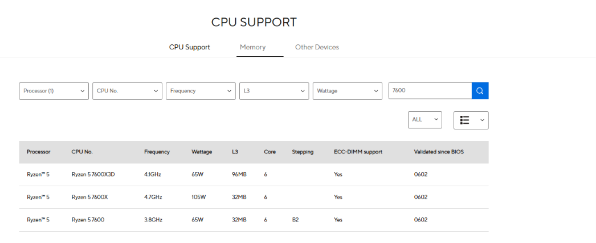
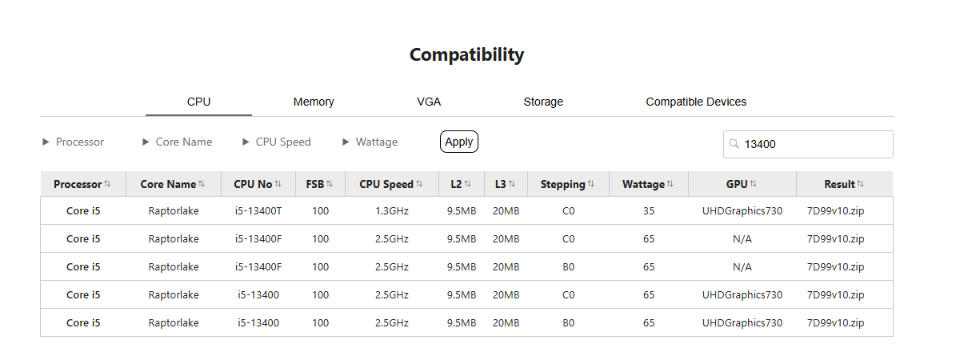

# Lab 3 — Teardown, and the same machine from the command line

Pair: Bostan Temirlan (No Pair)

Driver first half: Bostan

Machine: Host Acer Nitro AN515-57 (Windows 11), guest Innotech (Ubuntu Server in VirtualBox). Windows commands were run on the host, Linux commands inside the guest.

Date: 10.11.2026

## Part 1 — Ten parts

All facts below come from the makers' own pages, not from shops. Every part has screenshots of the product page and of its specification table (for the boards also the CPU support list), and three answers: what it is, what it connects to, what limits it.

### 1. AMD Ryzen 5 7600

**What it is:** desktop CPU with 6 cores and 12 threads, 3.8 GHz base clock, boost up to 5.1 GHz, 6 MB L2 and 32 MB L3 cache, 65 W TDP, integrated AMD Radeon Graphics (2 graphics cores, 2200 MHz).

**Connects to:** socket **AM5** (chipsets A620, B650, B650E, X670, X670E, B840, B850, X870, X870E). The memory controller is **DDR5** only, two channels, UDIMM, up to 128 GB.

**Limit:** the socket and the memory generation — it works only in AM5 boards and cannot use DDR4. AMD rates it for DDR5-5200 with two modules (DDR5-3600 with four), so faster memory is overclocking.

Source: https://www.amd.com/en/products/processors/desktops/ryzen/7000-series/amd-ryzen-5-7600.html

### 2. Intel Core i5-13400

**What it is:** desktop CPU with 10 cores (6 Performance + 4 Efficient) and 16 threads. P-cores 2.50 GHz base / 4.60 GHz turbo, E-cores 1.80 / 3.30 GHz, 20 MB Intel Smart Cache, integrated Intel UHD Graphics 730.

**Connects to:** socket **FCLGA1700** (LGA1700). The memory controller takes **DDR5 up to 4800 MT/s or DDR4 up to 3200 MT/s**, 2 channels, up to 192 GB.

**Limit:** only LGA1700 boards. The CPU supports two memory generations, but a board has slots for only one of them, so the board makes that choice. The package section gives only "Thermal Solution Specification: PCG 2020C" and does not say that a cooler is in the box.

Source: https://www.intel.com/content/www/us/en/products/sku/230495/specifications.html

### 3. ASUS PRIME B650M-A

**What it is:** micro-ATX motherboard built on the **AMD B650** chipset.

**Connects to:** socket **AM5** (CPUs up to 170 W); **4 × DDR5 DIMM** slots, DDR5-4800 to 5200 and 5400/5600 as overclock, dual channel, AMD EXPO; 2 × M.2 Key M (M.2_1 is PCIe 5.0 x4 with Ryzen 9000/7000, M.2_2 is PCIe 4.0 x4 from the chipset); 4 × SATA 6 Gb/s.

**CPU generations:** AMD Ryzen 9000, 8000 and 7000 desktop processors. In ASUS's CPU support list the Ryzen 5 7600 (3.8 GHz, 65 W, 32 MB L3, 6 cores, stepping B2) is validated since BIOS **0602**. A board made before that BIOS would need an update before it starts with this CPU; the page does not say which BIOS a board in a shop already has.

**Limit:** AM5 processors only and DDR5 only — an Intel CPU or a DDR4 module physically does not fit.

Sources:

https://www.asus.com/motherboards-components/motherboards/prime/prime-b650m-a/

https://asus.com/motherboards-components/motherboards/prime/prime-b650m-a/techspec

https://www.asus.com/motherboards-components/motherboards/prime/prime-b650m-a/helpdesk_qvl_cpu?model2Name=PRIME-B650M-A

### 4. MSI PRO B760M-A WIFI DDR4

**What it is:** micro-ATX motherboard (the "M" in the name) built on the **Intel B760** chipset.

**Connects to:** socket **LGA 1700**; **4 × DDR4** slots, up to 128 GB, 3200 MHz as JEDEC and up to 5333+ only as overclock, dual channel, non-ECC unbuffered, Intel XMP; 2 × M.2 (M.2_1 from the CPU, PCIe 4.0 x4; M.2_2 from the chipset, PCIe 4.0 x4 or SATA mode); 4 × SATA 6G. SATA8 is disabled when an M.2 SATA SSD is installed in M2_2.

**CPU generations:** Intel Core 14th / 13th / 12th Gen, Pentium Gold, Celeron. In MSI's compatibility list the i5-13400 (Raptor Lake, 2.5 GHz, 20 MB L3, 65 W, UHD Graphics 730) is listed in steppings B0 and C0, both with BIOS **7D99v10** — version 1.0, the first BIOS of this board (7D99 is MSI's code for it). So the CPU works without a BIOS update.

**Limit:** LGA1700 processors only and DDR4 only, although the CPU itself could also run DDR5.

Sources:

https://www.msi.com/Motherboard/PRO-B760M-A-WIFI-DDR4

https://www.msi.com/Motherboard/PRO-B760M-A-WIFI-DDR4/Specification

https://www.msi.com/Motherboard/PRO-B760M-A-WIFI-DDR4/support#cpu

### 5. Kingston FURY Beast DDR5-5600, 16 GB

**What it is:** one DDR5 DIMM, 16 GB, **288 pins**, single rank (1Rx8), On-Die ECC, 34.9 mm high with heatsink. Out of the box it runs at the JEDEC speed DDR5-4800 (CL40-39-39, 1.1 V); the 5600 MT/s in its name is Intel XMP 3.0 profile #1 (CL40-40-40, 1.25 V).

**Connects to:** a DDR5 DIMM slot on a desktop board.

**Limit:** DDR5 boards only. The advertised 5600 MT/s needs the profile to be switched on in the BIOS, and it is above the DDR5-5200 that AMD rates the Ryzen 5 7600 for.

Source: https://www.kingston.com/en/memory/gaming/kingston-fury-beast-ddr5-memory

Datasheet: https://www.kingston.com/datasheets/KF556C40BB-16.pdf

### 6. Crucial DDR4-3200, 16 GB DIMM

**What it is:** one DDR4 UDIMM (unbuffered desktop module), 16 GB, DDR4-3200, CAS latency 22 (22-22-22), 1.2 V, kit quantity 1, part number CT16G4DFRA32A.

**Connects to:** a DDR4 DIMM slot on a desktop board.

**Limit:** DDR4 boards only. A DDR4 module has the key notch in another place than DDR5, so it cannot be pushed into a DDR5 slot. It is a desktop UDIMM, not a laptop SO-DIMM either.

Source: https://www.crucial.com/memory/ddr4/ct16g4dfra32a

### 7. Samsung 990 PRO 1 TB

**What it is:** NVMe SSD, model MZ-V9P1T0BW, 1,000 GB, **M.2 (2280)**, **PCIe Gen 4.0 x4 / NVMe 2.0**, up to 7,450 MB/s sequential read and 6,900 MB/s write, Samsung V-NAND TLC.

**Connects to:** an M.2 slot on the board. Data and power both go through the slot, no cables.

**Limit:** the slot. It needs an M.2 slot wired for PCIe, and the link runs at the slower side: a PCIe 5.0 slot gives it nothing extra, a PCIe 3.0 slot would slow it down.

Source: https://www.samsung.com/in/memory-storage/nvme-ssd/990-pro-1tb-nvme-pcie-gen-4-mz-v9p1t0bw/

### 8. Samsung 870 EVO 1 TB

**What it is:** SATA SSD, 1,000 GB, **2.5 inch**, **SATA 6 Gb/s** (compatible with SATA 3 Gb/s and 1.5 Gb/s), up to 560 MB/s sequential read and 530 MB/s write, Samsung V-NAND 3-bit MLC.

**Connects to:** a SATA port on the board through a data cable, and a SATA power plug from the power supply — two cables.

**Limit:** the SATA bus. About 550 MB/s is the ceiling of the interface, however fast the flash inside is. That is roughly 13 times slower than the 990 PRO.

Source: https://www.samsung.com/sg/memory-storage/sata-ssd/870-evo-1tb-sata-3-2-5-ssd-mz-77e1t0bw/

### 9. Corsair RM750e (750 W)

**What it is:** ATX power supply, **750 W** continuous, **80 PLUS Gold** (Cybenetics Gold, noise A-), **ATX12V 3.1** and PCIe 5.1, **fully modular** with Type 4 cables, Zero RPM fan mode.

**Connects to:** the motherboard through the ATX connector (1 listed), drives through SATA power (7) and PATA/Molex (4). The Tech Specs table does not list the CPU (EPS) and PCIe cables, so their number is not confirmed from this page.

**Limit:** 750 W for everything in the case, and the cables that come with it — and there is one of it for two computers.

Source: https://www.corsair.com/us/en/p/psu/cp-9020262-na/rme-series-rm750e-fully-modular-low-noise-atx-power-supply-cp-9020262-na

### 10. Stock cooler — AMD Wraith Stealth

**Which processor ships with one:** the **Ryzen 5 7600**. Its AMD page lists "Thermal Solution (PIB): AMD Wraith Stealth", and AMD's cooler page puts the Ryzen 5 7600 in the list of processors bundled with the "AMD Wraith Stealth Cooler (no LED)". Intel's page for the i5-13400 gives only a thermal specification code and no boxed cooler.

**What it is:** a low-profile air cooler with one fan, no LED.

**Connects to:** the AM5 socket mount and a CPU fan header on the board.

**Limit:** it is the cooler for the 65 W processors it is sold with; AMD gives no cooling capacity in watts on the page.

Source: https://www.amd.com/en/products/processors/ecosystem/cpu-cooler-solutions.html

## Two builds

How I split the parts: the socket goes first. One CPU is AM5, the other is LGA1700, and there is exactly one board for each. After that the memory has no choice either — the ASUS board has DDR5 slots, the MSI board has DDR4 slots. Only the SSDs are free: each board has both M.2 and SATA, so either drive works in either build. I gave the NVMe drive to the AMD build because its first M.2 slot is the faster one.

### Build 1 — AMD

| Part | Model | Why it fits here |
|---|---|---|
| Processor | AMD Ryzen 5 7600 | needs socket AM5 |
| Motherboard | ASUS PRIME B650M-A | has socket AM5; ASUS lists the Ryzen 5 7600 (BIOS 0602 or newer) |
| Memory | Kingston FURY Beast DDR5-5600 16 GB | CPU and board are DDR5 only; goes into one of 4 DDR5 slots |
| SSD | Samsung 990 PRO 1 TB | M.2 2280 into slot M.2_1; the slot is PCIe 5.0, the drive works at its own PCIe 4.0 |
| Cooler | AMD Wraith Stealth | comes in the box of this CPU, made for AM5 |
| Power supply | Corsair RM750e | ATX power supply with the board connector; 750 W is many times more than a 65 W CPU without a graphics card needs |

**Still needs:** a case, a monitor, a keyboard and mouse, an operating system. A graphics card is not needed: the CPU has Radeon Graphics and the board has DisplayPort, HDMI and VGA outputs.

### Build 2 — Intel

| Part | Model | Why it fits here |
|---|---|---|
| Processor | Intel Core i5-13400 | needs socket LGA1700 |
| Motherboard | MSI PRO B760M-A WIFI DDR4 | has socket LGA1700; MSI lists the i5-13400 (B0 and C0) from its first BIOS |
| Memory | Crucial DDR4-3200 16 GB DIMM | board has DDR4 slots only; 3200 MT/s is exactly the top DDR4 speed of this CPU and the board's JEDEC speed |
| SSD | Samsung 870 EVO 1 TB | SATA drive to one of 4 SATA 6G ports |

**Still needs:** a **power supply**, a **CPU cooler**, a SATA data cable for the SSD, a case, a monitor, a keyboard and mouse, an operating system. A graphics card is not needed: the CPU has UHD Graphics 730 and the board has HDMI and DisplayPort outputs.

**Is there enough for two computers?** No. Ten parts give one power supply and one cooler, so only Build 1 can be switched on. Build 2 has a CPU, a board, memory and a drive, but nothing to power or cool it. Each build also has a single memory module, so both run in single-channel mode until a second module is added.

## Part 2 — Same facts, two operating systems

Windows is the host (real hardware). Linux is the Ubuntu guest in VirtualBox, so its column describes the **virtual machine**. Nobody in the pair has a Mac, so there is no macOS column.

| Fact | Windows (PowerShell), host | Linux, guest |
|---|---|---|
| CPU model | `Get-CimInstance Win32_Processor \| Select Name` → 11th Gen Intel Core i5-11400H @ 2.70GHz | `lscpu` (Model name) → 11th Gen Intel Core i5-11400H @ 2.70GHz |
| Cores / threads | `... Select NumberOfCores, NumberOfLogicalProcessors` → 6 / 12 | `lscpu` (Core(s) per socket, Thread(s) per core, CPU(s)) → 3 cores, 1 thread per core, 3 CPUs |
| Clock speed | `... Select MaxClockSpeed` → 2688 MHz | `lscpu` → no MHz line at all, only "@ 2.70GHz" inside the model name |
| Total memory | `Get-CimInstance Win32_PhysicalMemory` (sum of Capacity) → 8,589,934,592 B = 8 GiB | `free -h` → 3.3 GiB total, 2.9 GiB available, no swap |
| Memory modules and speed | `Get-CimInstance Win32_PhysicalMemory \| Select DeviceLocator, Capacity, Speed, SMBIOSMemoryType, FormFactor` → 1 module (Controller1-ChannelA-DIMM0), 3200 MT/s, type 26 = DDR4, form factor 12 = SO-DIMM | `sudo dmidecode -t memory` → "SMBIOS 2.5 present" and nothing else: no module, no size, no speed |
| Disk model and type | `Get-PhysicalDisk \| Select FriendlyName, MediaType, BusType, Size` → NVMe WDC PC SN530 SDBPNPZ-512G, SSD, BusType **RAID**, 512,110,190,592 B | `lsblk -d -o NAME,MODEL,ROTA,TRAN,SIZE` → `sda`, **VBOX HARDDISK**, ROTA 1 (rotating disk), TRAN sata, 25G |
| Free space | `Get-Volume C` → 87.4 GB free of 377.61 GB | `df -h /` → 20G free of 25G on /dev/sda2 |
| Architecture | `$env:PROCESSOR_ARCHITECTURE` → AMD64 | `uname -m` → x86_64 |

**How the names differ.** The same fact has a different name on each system: Windows says `NumberOfLogicalProcessors`, Linux says `CPU(s)`; the architecture is `AMD64` in Windows and `x86_64` in Linux, which is the same 64-bit x86 instruction set under two names. Windows prints sizes in raw bytes (8589934592) and memory type as a number from the SMBIOS table (26 = DDR4), while Linux prints human units (3.3Gi, 25G) and needs `sudo` to read the same firmware table.

**What the VM showed differently from the host.** The guest sees the real CPU model, because VirtualBox passes the processor name through, but only the **3 vCPUs** I gave it, with 1 thread per core instead of 6 cores / 12 threads; `lscpu` also names the hypervisor (`Hypervisor vendor: KVM` — the paravirtualization interface VirtualBox offers to Linux guests, not a different hypervisor) and adds a `hypervisor` flag. The cache lines are summed per vCPU (`L3 cache: 36 MiB (3 instances)`), so they are not the real cache of the chip. Memory is 3.3 GiB instead of 8 GiB, and `dmidecode` shows no memory module at all, because the virtual firmware has no real DIMM to describe. The biggest difference is the disk: the host has an NVMe SSD, but the guest sees a **SATA "VBOX HARDDISK"** that even reports itself as rotating (ROTA 1). It is a 25 GB file on the host's SSD, and the hypervisor hides everything about the real drive.

## What did not work the first time

1. **The disk said RAID, not NVMe.** My laptop has one NVMe SSD (WDC PC SN530), so I expected `Get-PhysicalDisk` to show `BusType NVMe`. It showed `BusType RAID`, although there is no RAID array in this laptop. I opened Device Manager → Storage controllers and found **Intel RST VMD Controller 9A0B** and **Intel RST VMD Managed Controller 09AB** (see [evidence/photos/device-manager-rst-vmd.png](evidence/photos/device-manager-rst-vmd.png)). The NVMe drive is connected through Intel's VMD controller and its Rapid Storage Technology driver, and Windows reports the bus of that driver instead of the bus of the drive. So `BusType` alone is not enough here; the model name (`NVMe WDC PC SN530`) and `MediaType SSD` are what tell the real type.
2. **The first set of specification screenshots did not prove my captions.** My first plan was one specification screenshot per part. For the Intel Core i5-13400 that was the "Memory Specifications" block only. When I checked each caption against its screenshots, I saw that the caption also gives the core count, clocks, cache, integrated graphics and socket, and none of that was visible in the memory block. After that I used one rule: every number in a caption must be readable on at least one screenshot. I added separate screenshots for the Intel CPU and Package specifications and for the CPU support lists of both boards, and I took out of the captions the numbers that none of my screenshots shows.
3. **SSH to the guest was refused.** To copy `linux-specs.txt` to the host I ran `ssh -p 2222 bostan@127.0.0.1`, as in Lab 1, and got `connect to host 127.0.0.1 port 2222: Connection refused`. The VM was running. In Lab 2 I had moved the guest from the plain "NAT" adapter to the NAT Network `osarch-net`, and the port forwarding rule from Lab 1 belonged to the old adapter, so nothing listened on port 2222 any more. A NAT Network has no port forwarding in the VM's own network settings; it is set for the whole network in File → Tools → Network Manager → NAT Networks → osarch-net → Port Forwarding. I added a rule TCP 127.0.0.1:2222 → guest port 22, and then `scp -P 2222 bostan@127.0.0.1:~/linux-specs.txt evidence\linux-specs.txt` copied the file (3650 bytes).

## Evidence

- [evidence/photos/ryzen5-7600.png](evidence/photos/ryzen5-7600.png), [ryzen5-7600-specs.png](evidence/photos/ryzen5-7600-specs.png) — AMD page: 6 cores / 12 threads, 65 W, AM5, DDR5, Wraith Stealth in the box, Radeon Graphics
- [evidence/photos/i5-13400.png](evidence/photos/i5-13400.png), [i5-13400-cpu-specs.png](evidence/photos/i5-13400-cpu-specs.png), [i5-13400-memory.png](evidence/photos/i5-13400-memory.png), [i5-13400-socket.png](evidence/photos/i5-13400-socket.png) — Intel page: 10 cores / 16 threads, DDR5-4800 or DDR4-3200, UHD Graphics 730, FCLGA1700
- [evidence/photos/asus-b650m-a.png](evidence/photos/asus-b650m-a.png), [asus-b650m-a-specs.png](evidence/photos/asus-b650m-a-specs.png), [asus-b650m-a-cpu-suppоrt.png](evidence/photos/asus-b650m-a-cpu-suppоrt.png) — ASUS board: AM5, B650, DDR5 slots, M.2 and SATA, CPU support list
- [evidence/photos/msi-b760m-a-ddr4.png](evidence/photos/msi-b760m-a-ddr4.png), [msi-b760m-a-ddr4-specs.png](evidence/photos/msi-b760m-a-ddr4-specs.png), [msi-specs-cpu-chipset.png](evidence/photos/msi-specs-cpu-chipset.png) — MSI board: LGA1700, B760, DDR4 slots, M.2 and SATA; compatibility list with the i5-13400 and BIOS 7D99v10
- [evidence/photos/kingston-ddr5-5600.png](evidence/photos/kingston-ddr5-5600.png), [kingston-ddr5-5600-specs.png](evidence/photos/kingston-ddr5-5600-specs.png) — Kingston module: DDR5, 288 pins, JEDEC 4800, XMP 5600
- [evidence/photos/crucial-ddr4-3200.png](evidence/photos/crucial-ddr4-3200.png), [crucial-ddr4-3200-specs.png](evidence/photos/crucial-ddr4-3200-specs.png) — Crucial module: DDR4 UDIMM, 16 GB, DDR4-3200, CL22, 1.2 V
- [evidence/photos/samsung-990-pro.png](evidence/photos/samsung-990-pro.png), [samsung-990-pro-specs.png](evidence/photos/samsung-990-pro-specs.png) — M.2 2280, PCIe Gen 4.0 x4, NVMe 2.0
- [evidence/photos/samsung-870-evo.png](evidence/photos/samsung-870-evo.png), [samsung-870-evo-specs.png](evidence/photos/samsung-870-evo-specs.png) — 2.5 inch, SATA 6 Gb/s
- [evidence/photos/corsair-rm750e.png](evidence/photos/corsair-rm750e.png), [corsair-rm750e-specs.png](evidence/photos/corsair-rm750e-specs.png) — 750 W, 80 PLUS Gold, ATX12V 3.1, fully modular
- [evidence/photos/wraith-stealth.png](evidence/photos/wraith-stealth.png) — AMD cooler page: Wraith Stealth is bundled with the Ryzen 5 7600
- [evidence/photos/device-manager-rst-vmd.png](evidence/photos/device-manager-rst-vmd.png) — Device Manager on the host: the NVMe disk sits behind Intel RST VMD controllers, which is why Windows says `BusType RAID`
- [evidence/windows-specs.txt](evidence/windows-specs.txt) — raw PowerShell output from the host, each command above its output
- [evidence/linux-specs.txt](evidence/linux-specs.txt) — raw output of the six commands inside the Ubuntu guest, each command above its output
