# Lab 3 — Teardown, and the same machine from the command line

Pair: Bostan Temirlan (No Pair)

Driver first half: Bostan

Machine: Host Acer Nitro AN515-57 (Windows 11), guest Innotech (Ubuntu Server in VirtualBox). Windows commands were run on the host, Linux commands inside the guest.

Date: 10.11.2026

## Part 1 — Ten parts

All facts below come from the makers' own pages, not from shops. Every part has two screenshots (the product page and its specification table) and three answers: what it is, what it connects to, what limits it.

### 1. AMD Ryzen 5 7600

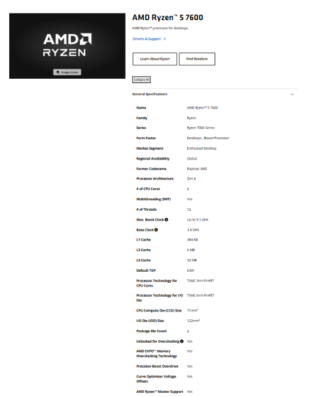
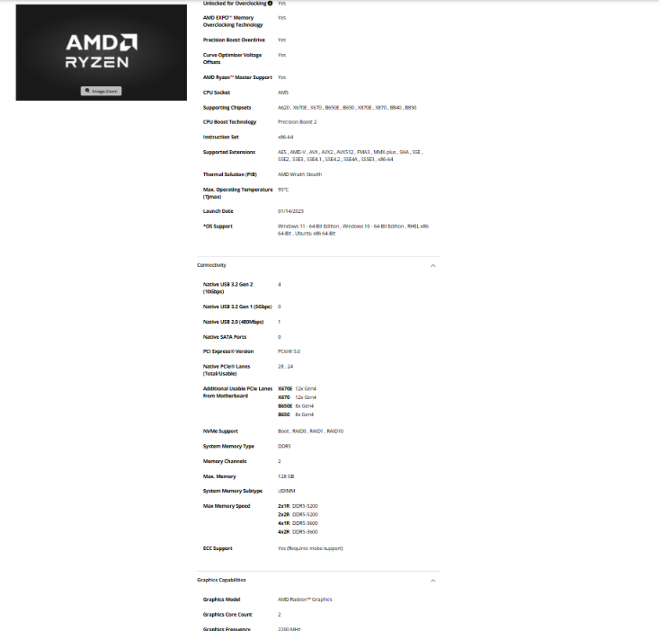

**What it is:** desktop CPU with 6 cores and 12 threads, 3.8 GHz base clock, boost up to 5.1 GHz, 6 MB L2 and 32 MB L3 cache, 65 W TDP, integrated Radeon Graphics.

**Connects to:** socket **AM5**. The memory controller is **DDR5** only, two channels, up to 128 GB.

**Limit:** the socket and the memory generation — it works only in AM5 boards and cannot use DDR4. AMD rates it for DDR5-5200 with two modules, so faster memory is overclocking.

Source: https://www.amd.com/en/products/processors/desktops/ryzen/7000-series/amd-ryzen-5-7600.html

### 2. Intel Core i5-13400

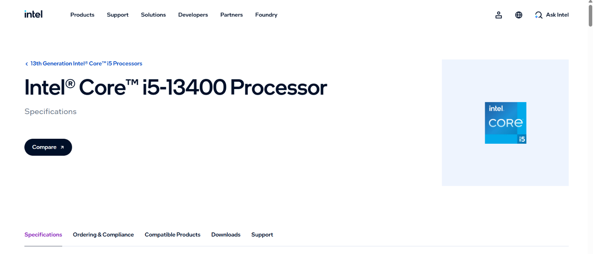
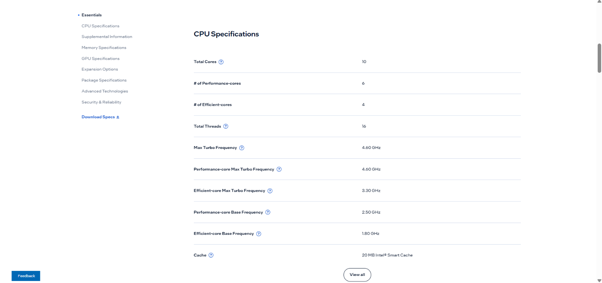
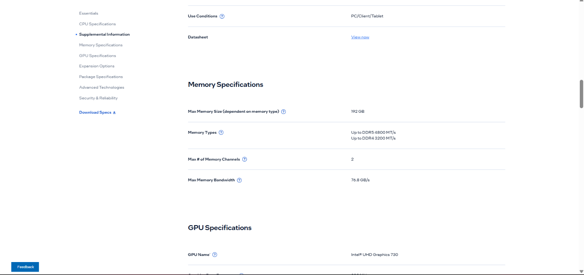
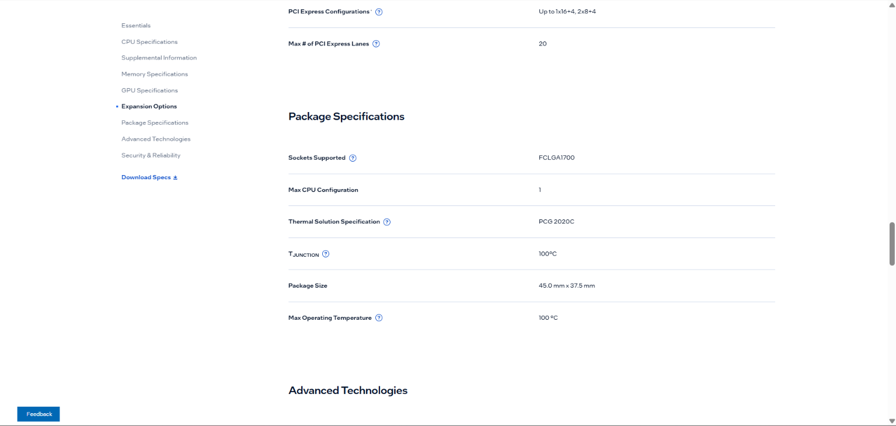
**What it is:** desktop CPU with 10 cores (6 Performance + 4 Efficient) and 16 threads, turbo up to 4.6 GHz, 20 MB cache, 65 W base power and 148 W maximum turbo power, integrated UHD Graphics 730.

**Connects to:** socket **LGA1700** (Intel writes FCLGA1700). The memory controller takes **DDR4 up to 3200 MT/s or DDR5 up to 4800 MT/s**, up to 192 GB.

**Limit:** only LGA1700 boards. The CPU supports two memory generations, but a board has slots for only one of them, so the board makes that choice. Intel's page does not say if a cooler is in the box.

Source: https://www.intel.com/content/www/us/en/products/sku/230495/specifications.html

### 3. ASUS PRIME B650M-A

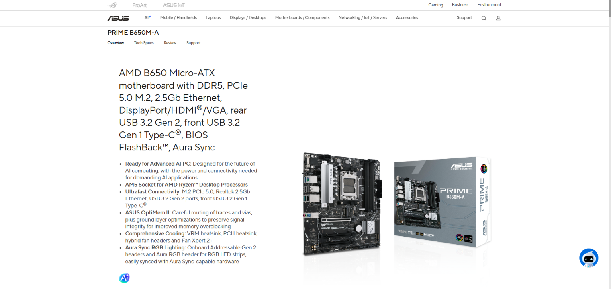
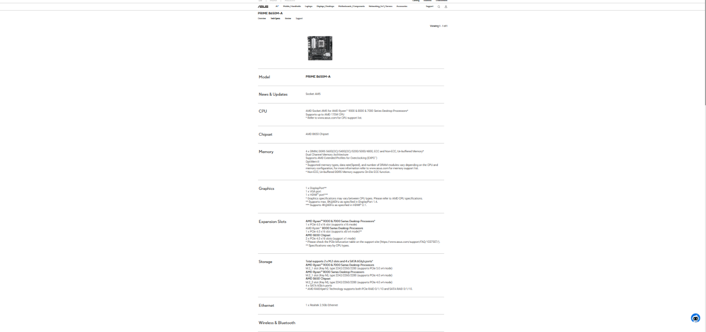

**What it is:** micro-ATX motherboard built on the **AMD B650** chipset.

**Connects to:** socket **AM5**; **4 × DDR5 DIMM** slots; 2 × M.2 (M.2_1 is PCIe 5.0 x4 with Ryzen 7000/9000, M.2_2 is PCIe 4.0 x4 from the chipset); 4 × SATA 6 Gb/s.

**CPU generations:** AMD Ryzen 7000, 8000 and 9000 desktop processors. BIOS for the Ryzen 5 7600: TODO (CPU Support list).

**Limit:** AM5 processors only and DDR5 only — an Intel CPU or a DDR4 module physically does not fit.

Source: https://asus.com/motherboards-components/motherboards/prime/prime-b650m-a/techspec

### 4. MSI PRO B760M-A WIFI DDR4

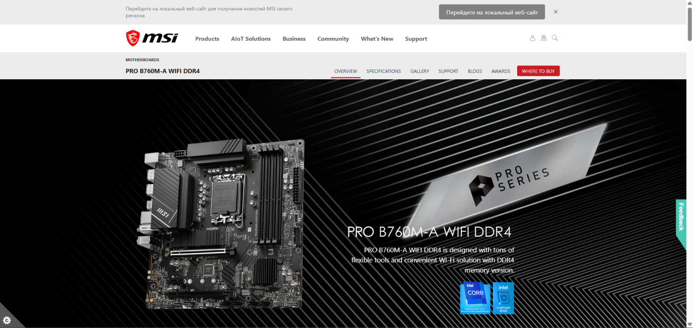
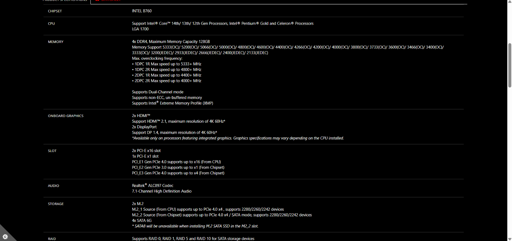

**What it is:** micro-ATX motherboard built on the **Intel B760** chipset.

**Connects to:** socket **LGA1700**; **4 × DDR4** slots, up to 128 GB; 2 × M.2 PCIe 4.0 x4 (the second one also accepts SATA M.2); 4 × SATA 6 Gb/s. One SATA port switches off if a SATA M.2 drive sits in M.2_2.

**CPU generations:** Intel Core 12th, 13th and 14th Gen, Pentium Gold, Celeron. BIOS for the i5-13400: TODO (CPU Support list).

**Limit:** LGA1700 processors only and DDR4 only, although the CPU itself could also run DDR5.

Source: https://www.msi.com/Motherboard/PRO-B760M-A-WIFI-DDR4/Specification

### 5. Kingston FURY Beast DDR5-5600, 16 GB

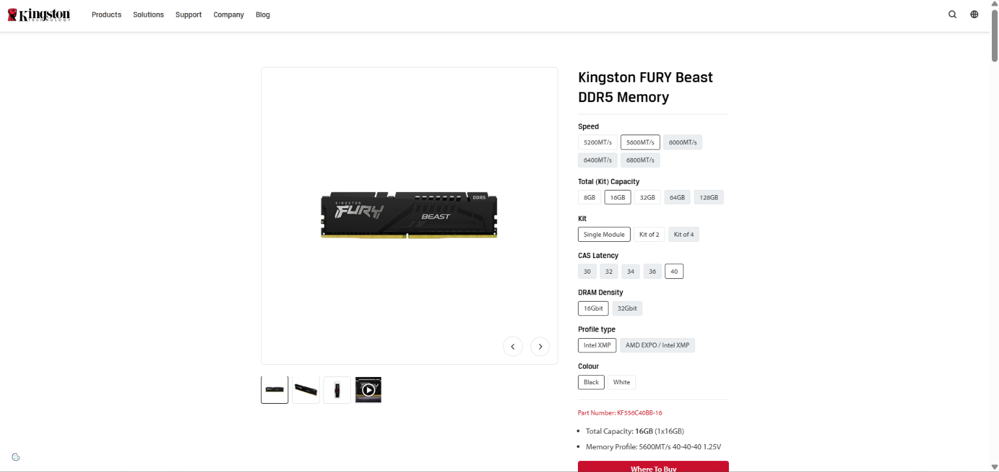
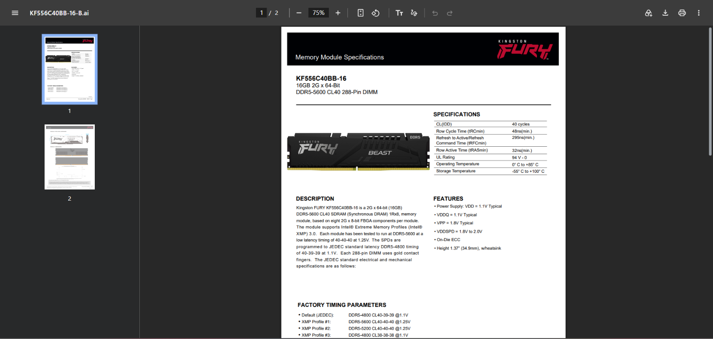

**What it is:** one DDR5 DIMM, 16 GB, **288 pins**, single rank. Out of the box it runs at the standard DDR5-4800 (CL40, 1.1 V); the 5600 MT/s in its name is an Intel XMP 3.0 profile at 1.25 V.

**Connects to:** a DDR5 DIMM slot on a desktop board.

**Limit:** DDR5 boards only. The advertised 5600 MT/s needs the profile to be switched on in the BIOS, and it is above the DDR5-5200 that AMD rates the Ryzen 5 7600 for.

Source: https://www.kingston.com/en/memory/gaming/kingston-fury-beast-ddr5-memory · Datasheet: https://www.kingston.com/datasheets/KF556C40BB-16.pdf

### 6. Crucial DDR4-3200, 16 GB DIMM

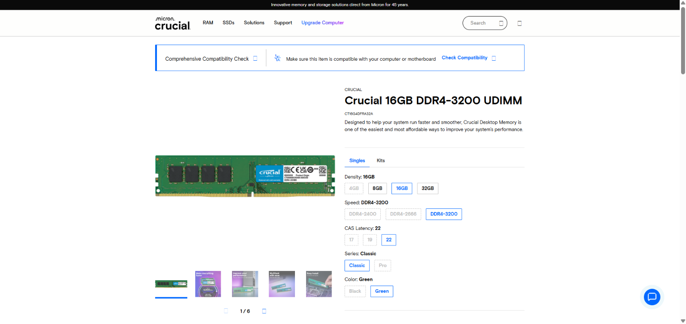
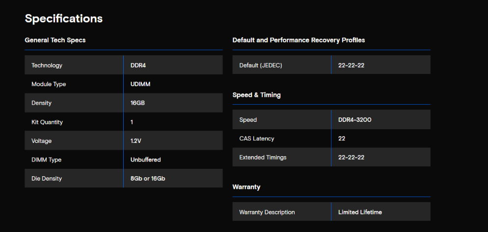

**What it is:** one DDR4 UDIMM (desktop size), 16 GB, 3200 MT/s, CL22, 1.2 V, part number CT16G4DFRA32A.

**Connects to:** a DDR4 DIMM slot on a desktop board.

**Limit:** DDR4 boards only. It has as many pins as a DDR5 module, but the key notch sits in another place, so it cannot be pushed into a DDR5 slot. It is not a laptop SO-DIMM either.

Source: https://www.crucial.com/memory/ddr4/ct16g4dfra32a

### 7. Samsung 990 PRO 1 TB

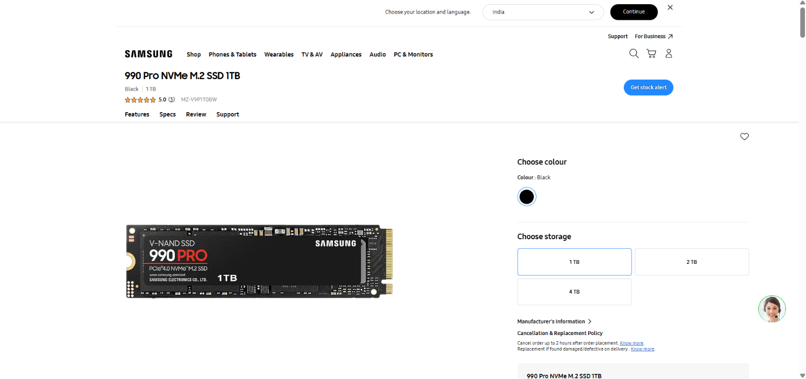
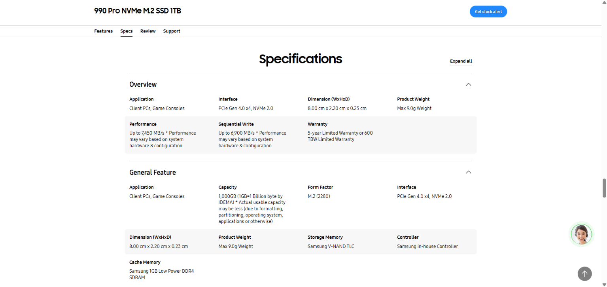

**What it is:** NVMe SSD, 1 TB, **M.2 2280**, **PCIe 4.0 x4 / NVMe 2.0**, up to 7,450 MB/s sequential read and 6,900 MB/s write.

**Connects to:** an M.2 slot on the board. Data and power both go through the slot, no cables.

**Limit:** the slot. It needs an M.2 slot wired for PCIe, and the link runs at the slower side: a PCIe 5.0 slot gives it nothing extra, a PCIe 3.0 slot would slow it down.

Source: https://www.samsung.com/ca/memory-storage/nvme-ssd/990-pro-1tb-nvme-pcie-gen-4-mz-v9p1t0b-am

### 8. Samsung 870 EVO 1 TB

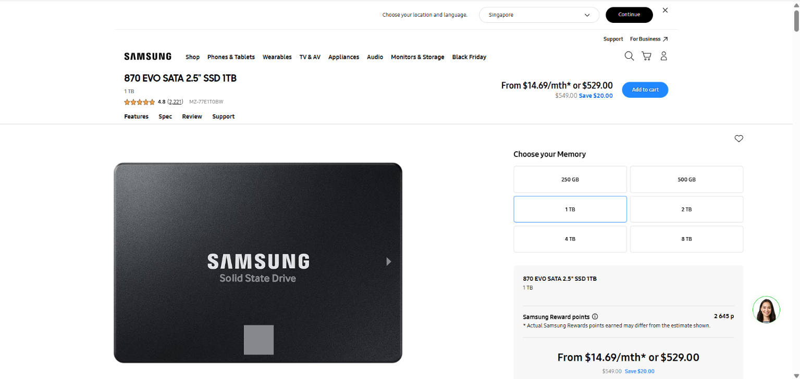
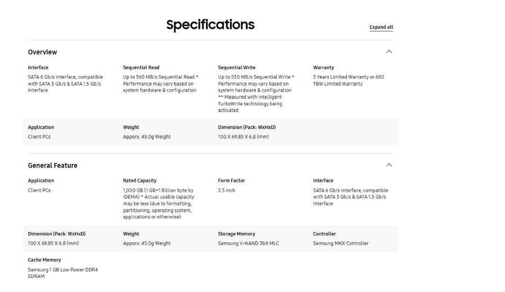

**What it is:** SATA SSD, 1 TB, **2.5-inch**, **SATA 6 Gb/s**, up to 560 MB/s sequential read and 530 MB/s write.

**Connects to:** a SATA port on the board through a data cable, and a SATA power plug from the power supply — two cables.

**Limit:** the SATA bus. About 550 MB/s is the ceiling of the interface, however fast the flash inside is. That is roughly 13 times slower than the 990 PRO.

Source: https://www.samsung.com/uk/memory-storage/sata-ssd/870-evo-1tb-sata-3-2-5-ssd-mz-77e1t0b-eu

### 9. Corsair RM750e (750 W)

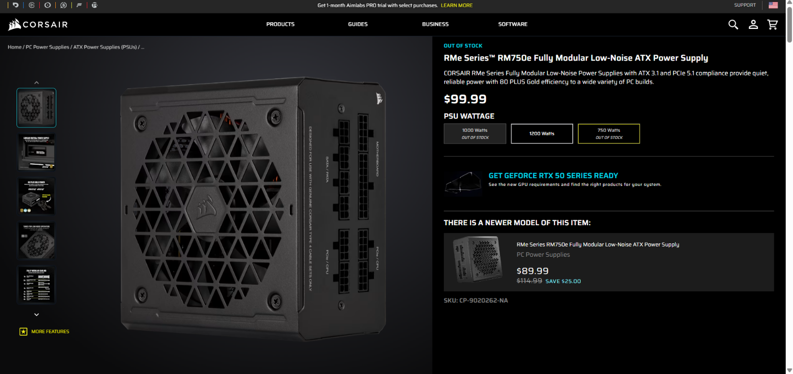
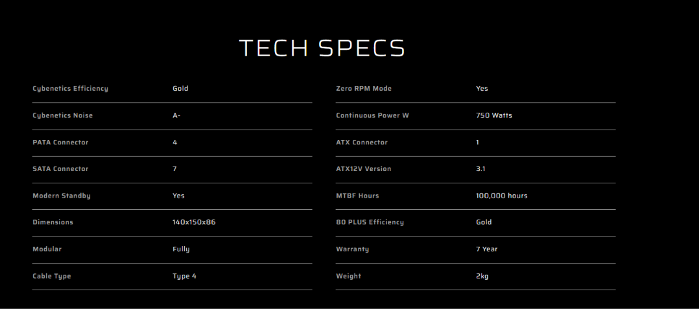

**What it is:** ATX power supply, **750 W**, 80 PLUS Gold, ATX 3.1, fully modular (every cable can be unplugged).

**Connects to:** the board with the 24-pin cable and the EPS 8-pin CPU cable (it has two), drives with SATA power (7 plugs), a graphics card with PCIe 8-pin or 12V-2x6.

**Limit:** 750 W for everything in the case — and there is one of it for two computers.

Source: https://www.corsair.com/p/CP-9020262-EU

### 10. Stock cooler — AMD Wraith Stealth

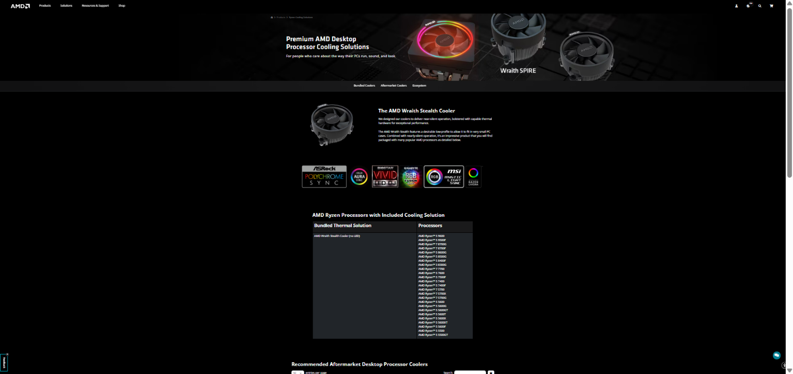

**Which processor ships with one:** the **Ryzen 5 7600**. Its AMD page lists "AMD Wraith Stealth" as the in-box thermal solution, and AMD's cooler page names the Ryzen 5 7600 among the processors bundled with it. Intel's page for the i5-13400 gives only a thermal specification code and no boxed cooler.

**What it is:** a low-profile air cooler with one fan, no LED.

**Connects to:** the AM5 socket mount and a CPU fan header on the board.

**Limit:** it is the cooler for the 65 W processors it is sold with; AMD gives no cooling capacity in watts on the page.

Source: https://www.amd.com/en/products/processors/ecosystem/cpu-cooler-solutions.html

## Two builds

How I split the parts: the socket goes first. One CPU is AM5, the other is LGA1700, and there is exactly one board for each. After that the memory has no choice either — the ASUS board has DDR5 slots, the MSI board has DDR4 slots. Only the SSDs are free: each board has both M.2 and SATA, so either drive works in either build. I gave the NVMe drive to the AMD build because its first M.2 slot is the faster one.

### Build 1 — AMD

| Part | Model | Why it fits here |
|---|---|---|
| Processor | AMD Ryzen 5 7600 | needs socket AM5 |
| Motherboard | ASUS PRIME B650M-A | has socket AM5; supports Ryzen 7000 |
| Memory | Kingston FURY Beast DDR5-5600 16 GB | CPU and board are DDR5 only; goes into one of 4 DDR5 slots |
| SSD | Samsung 990 PRO 1 TB | M.2 2280 into slot M.2_1; the slot is PCIe 5.0, the drive works at its own PCIe 4.0 |
| Cooler | AMD Wraith Stealth | comes in the box of this CPU, made for AM5 |
| Power supply | Corsair RM750e | 24-pin + EPS 8-pin for the board; 750 W is many times more than a 65 W CPU without a graphics card needs |

**Still needs:** a case, a monitor, a keyboard and mouse, an operating system. A graphics card is not needed: the CPU has Radeon Graphics and the board has video outputs.

### Build 2 — Intel

| Part | Model | Why it fits here |
|---|---|---|
| Processor | Intel Core i5-13400 | needs socket LGA1700 |
| Motherboard | MSI PRO B760M-A WIFI DDR4 | has socket LGA1700; supports 13th Gen |
| Memory | Crucial DDR4-3200 16 GB DIMM | board has DDR4 slots only; 3200 MT/s is exactly the top DDR4 speed of this CPU |
| SSD | Samsung 870 EVO 1 TB | SATA drive to one of 4 SATA 6 Gb/s ports |

**Still needs:** a **power supply**, a **CPU cooler**, a SATA data cable for the SSD, a case, a monitor, a keyboard and mouse, an operating system. A graphics card is not needed: the CPU has UHD Graphics 730.

**Is there enough for two computers?** No. Ten parts give one power supply and one cooler, so only Build 1 can be switched on. Build 2 has a CPU, a board, memory and a drive, but nothing to power or cool it. Each build also has a single memory module, so both run in single-channel mode until a second module is added.

## Part 2 — Same facts, two operating systems

Windows is the host (real hardware). Linux is the Ubuntu guest in VirtualBox, so its column describes the **virtual machine**. Nobody in the pair has a Mac, so there is no macOS column.

| Fact | Windows (PowerShell), host | Linux, guest |
|---|---|---|
| CPU model | `Get-CimInstance Win32_Processor \| Select Name` → TODO | `lscpu` → TODO |
| Cores / threads | `... Select NumberOfCores, NumberOfLogicalProcessors` → TODO | `lscpu` → TODO |
| Total memory | `Get-CimInstance Win32_PhysicalMemory` (sum of Capacity) → TODO | `free -h` → TODO |
| Memory modules and speed | `Get-CimInstance Win32_PhysicalMemory \| Select DeviceLocator, Capacity, Speed` → TODO | `sudo dmidecode -t memory` → TODO |
| Disk model and type | `Get-PhysicalDisk \| Select FriendlyName, MediaType, BusType, Size` → TODO | `lsblk -d -o NAME,MODEL,ROTA,TRAN,SIZE` → TODO |
| Free space | `Get-Volume C` → TODO | `df -h /` → TODO |
| Architecture | `$env:PROCESSOR_ARCHITECTURE` → TODO | `uname -m` → TODO |

**How the names differ.** TODO

**What the VM showed differently from the host.** TODO

## What did not work the first time

TODO

## Evidence

- [evidence/photos/ryzen5-7600.png](evidence/photos/ryzen5-7600.png), [ryzen5-7600-specs.png](evidence/photos/ryzen5-7600-specs.png) — AMD page: AM5, DDR5, 6 cores / 12 threads, 65 W, Wraith Stealth in the box
- [evidence/photos/i5-13400.png](evidence/photos/i5-13400.png), [i5-13400-specs.png](evidence/photos/i5-13400-specs.png) — Intel page: LGA1700, 10 cores / 16 threads, DDR4-3200 or DDR5-4800
- [evidence/photos/asus-b650m-a.png](evidence/photos/asus-b650m-a.png), [asus-b650m-a-specs.png](evidence/photos/asus-b650m-a-specs.png) — ASUS board: AM5, B650, DDR5 slots, M.2 and SATA
- [evidence/photos/msi-b760m-a-ddr4.png](evidence/photos/msi-b760m-a-ddr4.png), [msi-b760m-a-ddr4-specs.png](evidence/photos/msi-b760m-a-ddr4-specs.png) — MSI board: LGA1700, B760, DDR4 slots, M.2 and SATA
- [evidence/photos/kingston-ddr5-5600.png](evidence/photos/kingston-ddr5-5600.png), [kingston-ddr5-5600-specs.png](evidence/photos/kingston-ddr5-5600-specs.png) — Kingston module: DDR5, 288 pins, 5600 as XMP profile
- [evidence/photos/crucial-ddr4-3200.png](evidence/photos/crucial-ddr4-3200.png), [crucial-ddr4-3200-specs.png](evidence/photos/crucial-ddr4-3200-specs.png) — Crucial module: DDR4 UDIMM, 16 GB, 3200
- [evidence/photos/samsung-990-pro.png](evidence/photos/samsung-990-pro.png), [samsung-990-pro-specs.png](evidence/photos/samsung-990-pro-specs.png) — M.2 2280, PCIe 4.0 x4
- [evidence/photos/samsung-870-evo.png](evidence/photos/samsung-870-evo.png), [samsung-870-evo-specs.png](evidence/photos/samsung-870-evo-specs.png) — 2.5-inch, SATA 6 Gb/s
- [evidence/photos/corsair-rm750e.png](evidence/photos/corsair-rm750e.png), [corsair-rm750e-specs.png](evidence/photos/corsair-rm750e-specs.png) — 750 W, 80 PLUS Gold, fully modular
- [evidence/photos/wraith-stealth.png](evidence/photos/wraith-stealth.png) — AMD cooler page: Wraith Stealth is bundled with the Ryzen 5 7600
- [evidence/windows-specs.txt](evidence/windows-specs.txt) — raw PowerShell output from the host, each command above its output
- [evidence/linux-specs.txt](evidence/linux-specs.txt) — raw output of the six commands inside the Ubuntu guest
