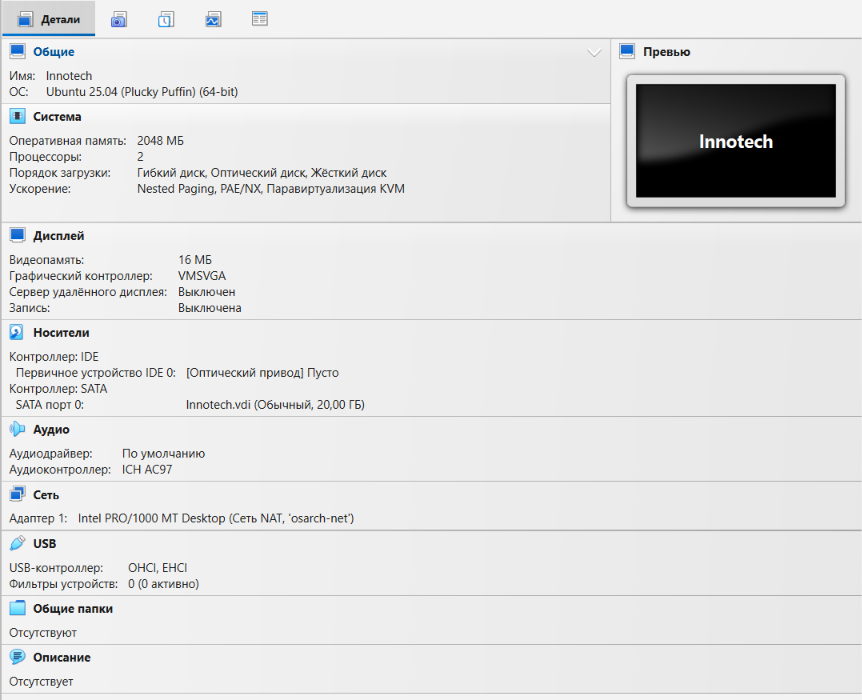
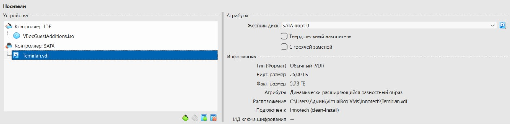
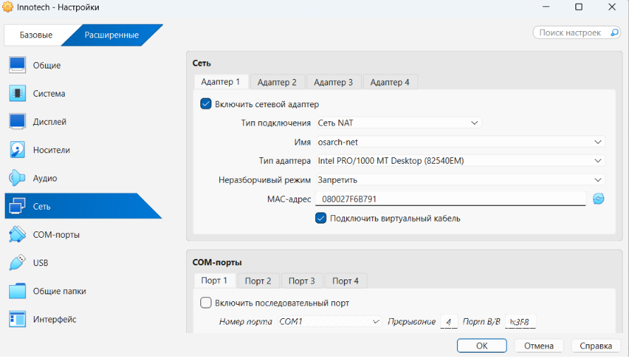
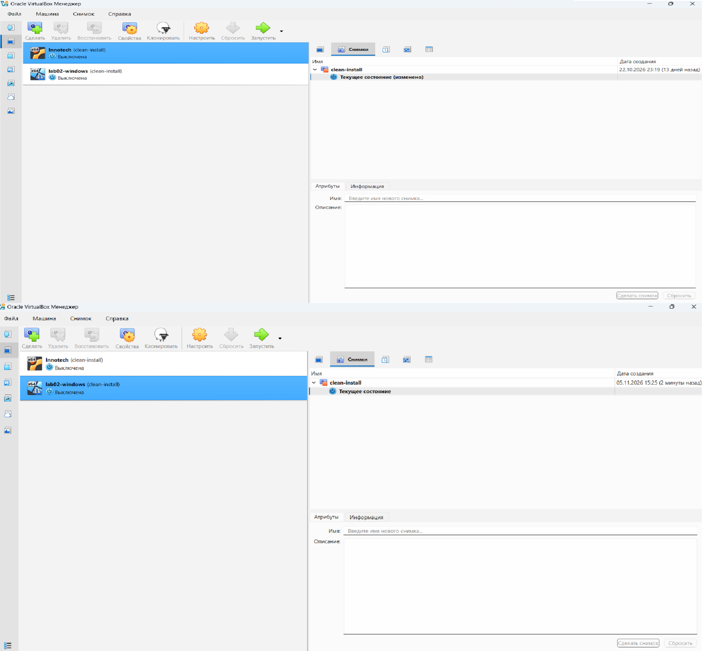

# Developer Test Machine — Rebuild Guide

**Target Audience:** Office Management / IT Onboarding (Aigerim T.)
**Purpose:** Rebuilding isolated Linux and Windows virtual test machines from scratch without risking host stability.

---

## Prerequisites: What to Download

1. **Hypervisor (Oracle VirtualBox 7.x & Extension Pack):** Download from virtualbox.org. It is free for educational and evaluation use under the VirtualBox PUEL/GPL licence.
2. **Ubuntu Server 24.04 LTS ISO:** Download the Server ISO from ubuntu.com. Server edition has no graphical desktop environment, saving host CPU and RAM.
3. **Windows 11 Enterprise Evaluation ISO:** Download legally from the Microsoft Evaluation Center. This provides a legal 90-day sandbox environment without purchasing retail product keys.

---

## Step 1. Create the Shared Network (`osarch-net`)

1. Open VirtualBox, click **File** -> **Tools** -> **Network Manager**.
2. Switch to the **NAT Networks** tab and click **Create**.
3. Name it `osarch-net`, set IPv4 Prefix to `10.0.2.0/24`, and check **Enable DHCP**. Click **Apply**.

> **Why NAT Network and not Bridged:** The office and campus Wi-Fi networks filter traffic by MAC address, meaning a Bridged adapter gets blocked immediately. Standard NAT isolates virtual machines behind separate virtual routers where they cannot reach each other. `NAT Network` creates an internal subnet where both machines can communicate while sharing the laptop's internet connection.

---

## Step 2. Create and Install the Linux Virtual Machine (`Innotech`)

1. Click **New** in the VirtualBox top toolbar.
2. Set Name: `Innotech`, Type: `Linux`, Version: `Ubuntu (64-bit)`.
3. In Hardware settings, set Base Memory to **2048 MB (2 GB)** and Processors to **2 vCPU**.
4. In the Virtual Hard Disk screen, select **Create a Virtual Hard Disk Now**. Set File size to **25.00 GB** and select **Dynamically allocated** (Thin Provisioning). Click **Finish**.

> **Why 2 GB RAM and Dynamically Allocated:** Our host laptops have 8 GB of RAM total, and Windows 11 idle background processes occupy ~5.8 GB. Allocating more than 2 GB to the VM saturates physical RAM and freezes the host laptop completely. A dynamically allocated disk only consumes real SSD space when data is actually written.

**OS Installation Steps:**
1. Go to VM **Settings** -> **Storage**, mount the Ubuntu 24.04 ISO to the optical drive, and click **Start**.
2. Select **English** language and **English (US)** keyboard layout.
3. Choose **Ubuntu Server (minimized)** to save resources.
4. Leave the network interface on DHCP (it will receive a 10.0.2.x address later).
5. Select **Use an entire disk** and uncheck "Set up this disk as an LVM group". Confirm destructive action.
6. Create a user account (e.g., `bostan`).
7. **Crucial:** Check the box to **Install OpenSSH server** so developers can connect via terminal.
8. Wait for the installation to finish, select **Reboot Now**, and unmount the ISO.

---

## Step 3. Create and Install the Windows 11 Virtual Machine (`lab02-windows`)

1. Click **New** in VirtualBox.
2. Name: `lab02-windows`, Type: `Microsoft Windows`, Version: `Windows 11 (64-bit)`. Check **Skip Unattended Installation**.
3. Hardware: Base Memory **2048 MB (2 GB)**, Processors: **2 vCPU**, and check **Enable EFI**.
4. In System -> Security, ensure **TPM 2.0** is set to *Virtual TPM*.
5. Virtual Hard Disk: set Size to **64.00 GB**, choose **Dynamically allocated**, and click **Finish**.

> **Why EFI and TPM:** Windows 11 installer checks hardware requirements and aborts installation if UEFI boot and TPM 2.0 emulation are not enabled. We strictly allocate 2 GB RAM instead of Microsoft's recommended 4 GB to prevent host lockups on our 8 GB hardware.

**OS Installation Steps:**
1. Mount the Windows 11 ISO in Storage settings and **Start** the VM. Press any key to boot from CD.
2. Select **English (United States)**, click Next, then **Install Now**.
3. Accept the License Terms. Select **Custom: Install Windows only (advanced)**.
4. Select the `Drive 0 Unallocated Space (64.0 GB)` and click Next. Wait for the VM to reboot.
5. In the initial setup (OOBE): select your region and keyboard.
6. Choose **Set up for work or school** -> **Sign-in options** -> **Domain join instead**.
7. Enter a local username (e.g., `developer`) and password.
8. Turn off all diagnostic and privacy telemetry toggles to save CPU cycles.

---

## Step 4. Connect Both VMs to the Shared Network

1. Power off both VMs cleanly if they are running.
2. For `Innotech`, click **Settings** -> **Network**.
3. On Adapter 1, set Attached to: **NAT Network**.
4. In the Name field, select `osarch-net` and click **OK**.
5. Repeat this exact setting for `lab02-windows`.

---

## Step 5. Configure Windows Firewall for Inter-Guest Pings

1. Log into Windows 11, right-click the Start button, and select **Terminal (Admin)** or **PowerShell (Administrator)**.
2. Run this exact command:
   `New-NetFirewallRule -DisplayName "Allow ping in (ICMPv4)" -Protocol ICMPv4 -IcmpType 8 -Direction Inbound -Action Allow`

> **Why:** Windows Defender Firewall treats the virtual network adapter as a Public profile and silently drops incoming ICMP echo requests. Turning off the firewall entirely violates security policies; this command safely permits ping testing while keeping system security active.

**Check:** Start both VMs. From the Ubuntu console, run `ping 10.0.2.4` (or the assigned Windows IP). You should receive replies with 0% packet loss.

---

## Step 6. Take a Clean Baseline Snapshot

1. Shut down both virtual machines cleanly (Start -> Shut down in Windows; `sudo poweroff` in Linux).
2. Select `Innotech`, open the **Snapshots** panel on the right (list icon), click **Take**, and name it `clean-install`.
3. Repeat the exact process for `lab02-windows`.

> **Why:** This fulfills the requirement "without breaking anything". When the developer modifies system files or breaks networking, the machine can be instantly restored to day one.

---

## Step 7. Step-by-Step Rollback Procedure (When Developer Breaks Something)

When the developer encounters an OS failure, follow these exact steps to restore the clean baseline:

1. Power off the malfunctioning virtual machine completely. (If frozen, select **Machine** -> **Close** -> **Power off the machine**).
2. In the VirtualBox Manager, select the VM from the left list.
3. Open the **Snapshots** panel from the top-right menu.
4. Left-click the snapshot named `clean-install`.
5. Click the **Restore** button (circular counter-clockwise arrow icon).
6. A dialog box will appear asking: *"Do you want to create a snapshot of the current machine state?"*  
   **Uncheck** this option. We want to discard the broken state entirely.
7. Click the blue **Restore** button.
8. Start the VM. The guest boots immediately into its original working configuration.

---

## Step 8. Troubleshooting Common Problems

**Issue 1: Windows 11 Installer halts with "This PC can't run Windows 11"**
* **Cause:** The virtual machine was created without UEFI firmware enabled or the virtual TPM 2.0 module was omitted.
* **Fix:** Power off the VM. Open **Settings** -> **System**. On the Motherboard tab, check **Enable EFI**. On the Security tab, ensure **TPM 2.0** is set to **Virtual TPM v2.0**. Restart the installation.

**Issue 2: Ping between guests times out (100% packet loss)**
* **Cause:** Either one of the virtual machines is attached to standard "NAT" instead of "NAT Network (`osarch-net`)", or the Windows Defender Firewall ICMP rule was not applied.
* **Fix:** Ensure both VMs use `osarch-net` (Step 4) and re-run the PowerShell firewall command in Windows as Administrator (Step 5).
